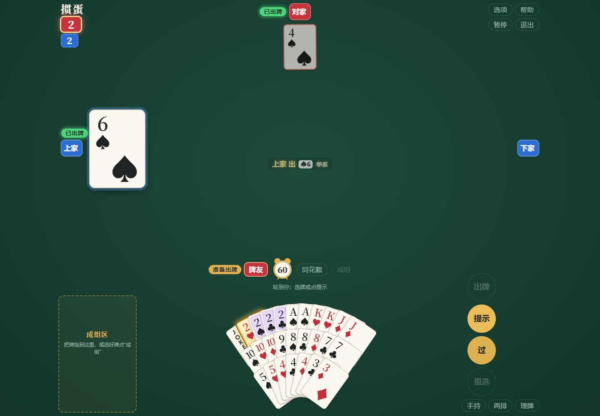
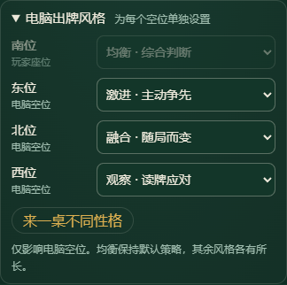
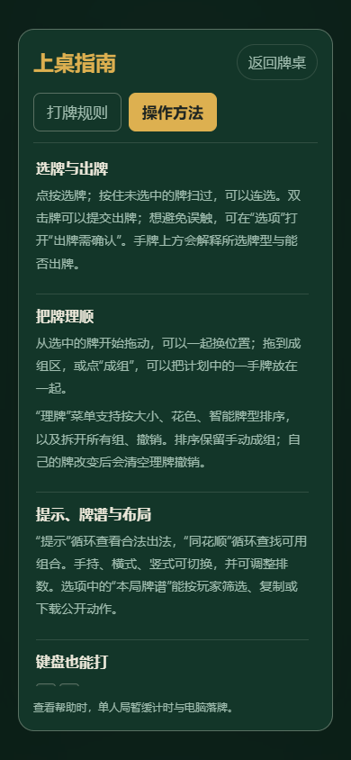

<div align="center">

# GuandanAI

### A table for friends. One link to play.

Four-player GuanDan with browser-local bots, private rooms and practical hand tools.

[](https://github.com/stevensun1005/guandanai/actions/workflows/pages.yml)
[](CHANGELOG.md)


**[Play now](https://stevensun1005.github.io/guandanai/) · [简体中文](README.md) · [Contributing](CONTRIBUTING.md)**

</div>



<details>
<summary>More views: bot personalities and mobile help</summary>

<p align="center"> </p>

</details>

## Bring your friends

1. Enter a nickname and create a room.
2. Pick a seat and copy the invitation link.
3. Friends open the link and take their seats. The host starts the game.

Empty seats are filled by bots. Play alone or with up to three friends. Keep the host's page open: the host runs the table and computes bot turns.

## What is included

| Feature             | In the game                                                                              |
| ------------------- | ---------------------------------------------------------------------------------------- |
| Four-player GuanDan | Two decks, wild cards, bombs, tribute, partner lead and level progression                |
| Friend rooms        | Invitations, seat selection, temporary bot takeover and original-tab recovery            |
| Local inference     | An RL value policy and an independent response network in a Web Worker                   |
| Five personalities  | Balanced, aggressive, conservative, observant and adaptive                               |
| Hand tools          | Dragging, sweeping, manual groups, smart/rank/suit ordering and 30-step arrangement undo |
| Clear actions       | Selection feedback, keyboard navigation and optional play confirmation                   |
| Public scorecards   | Filter public plays by player, copy or download the current round                        |
| Practice            | An explicit face-up solo table with notes, step-by-step play and portable records        |
| Static deployment   | GitHub Pages; no inference server or API key required                                    |

The personalities share the RL value policy. Observant and adaptive bots can additionally use a separately trained **supervised response classifier**. They are five playing styles, not five independently trained RL agents. Small endgames use exact search only when the remaining opponent hand is uniquely determined by public information.

[Bot behavior and evidence](docs/BOTS.md) · [Reproducible model training](docs/MODEL_TRAINING.md)

## Run locally

Node.js **20.19+** is required; CI uses Node.js 24.

```bash
git clone https://github.com/stevensun1005/guandanai.git
cd guandanai
npm ci
npm run build
npm run dev
```

Open **http://127.0.0.1:8765/**. Rebuild and refresh after source changes.

```bash
npm test
npm run format:check
npm run build
```

Python is a developer tool for model export, training and browser validation. Players and the static build do not need it. Tested Python dependencies are recorded in `requirements-dev.txt` and `requirements-models.txt`.

## A project with clear boundaries

```text
src/
  index.html          Page structure
  app.js              Explicit module initialization
  core/               Pure cards, combinations, candidates and validation
  game/               Dealing, tribute, turns, clocks and events
  hand/ input/        Arrangement, selection, gestures and keyboard actions
  ai/                 Features, profiles, model registry and Worker inference
  network/            Rooms, seat recovery, snapshots and voice
  lobby/ ui/          Lobby, table rendering and dialogs
  replay/             Practice records, import/export and public scorecards
  styles/ assets/     Feature styles and visual assets
ai/                   Model files and numerical reference
scripts/              Build, preview, data collection, training and evaluation
tests/                Node checks and real-browser scenarios
docs/                 Guides, architecture, evaluations and roadmap
```

Production assets are bundled into `dist/`; edit `src/`, not the build output. Rules do not depend on DOM or session state. Model observations are explicitly limited to the acting player's hand and public information.

## Publish

Push to `main` to run checks and deploy through GitHub Actions. Configure Pages to use **GitHub Actions** as its source. All inference resources are included in the static deployment.

The application uses relative asset URLs and supports repository subpaths. See the [deployment guide](docs/DEPLOYMENT.md).

## Recovery and boundaries

A guest can refresh the original browser tab or reconnect after a data-channel interruption. The host verifies the original seat credential, sends its current snapshot and cancels any unfinished bot turn for the returning player. A page-version mismatch blocks starting the table. If an incoming event queue stops advancing, the guest can resynchronize on the existing connection without extending the host’s turn clock.

Recovery is tab-local; it does not provide account-based or cross-device sign-in. The host must remain online. If the host leaves, guests can continue independently against local bots; automatic host migration is not implemented.

Validation covers desktop Chrome, simulated phone layouts, public PeerJS signaling, multiple browser contexts, full rounds, tribute and recovery races. Different physical devices and networks still need broader long-running playtests. See [testing](docs/TESTING.md) and [room recovery](docs/ROOMS.md).

## Improve one hand at a time

For a useful [issue](https://github.com/stevensun1005/guandanai/issues), include the device, browser, page version and steps. Rule or bot issues benefit from a concrete hand and the public actions leading to it. UI changes benefit from screenshots.

[Contributing](CONTRIBUTING.md) · [Changelog](CHANGELOG.md) · [Roadmap](docs/ROADMAP.md)
