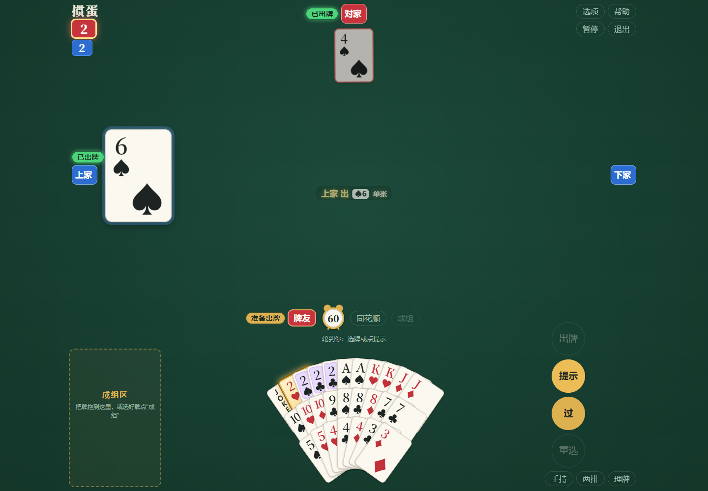
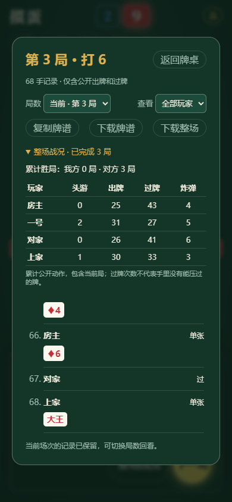

<div align="center">

# GuandanAI

### A table for friends. One link to play.

Four-player GuanDan with browser-local bots, private rooms and practical hand tools.

[](https://github.com/stevensun1005/guandanai/actions/workflows/pages.yml)
[](./CHANGELOG.md)


**[Play now](https://stevensun1005.github.io/guandanai/) · [Download a release](https://github.com/stevensun1005/guandanai/releases/latest) · [简体中文](./README.md) · [Contributing](./CONTRIBUTING.md)**

</div>



<details>
<summary>More views: mobile help and match history</summary>

<p align="center"> </p>

</details>

## Code and model entry points

[Web application](web/README.md) · [AI](ai/README.md) · [Local model](ai/local/README.md) · [GuanZero](ai/guanzero/README.md) · [Migration guide](ai/research/STRUCTURE_MIGRATION.md)

## Bring your friends

The in-game scorecard keeps earlier rounds, finishing orders and public action totals throughout the match. Switch rounds, filter players or download the whole public match log; held cards are excluded. Completed rounds also travel with seat recovery.

1. Enter a nickname and create a room.
2. Pick a seat and copy the invitation link.
3. Friends open the link and take their seats. The host starts the game.

Empty seats are filled by bots. Play alone or with up to three friends. Keep the host's page open: the host runs the table and computes bot turns.

Use the center of the lobby table to choose a starting level and compass team. The new final-chance option gives the other team one A attempt after a team has exhausted three; the table shows A1/A2/A3 or A末. Straight-flush selection now counts combinations and clears the selection after a full cycle.

## What is included

Online rounds with at least two people are archived as structured, pseudonymous records after completion. The host uploads once, with offline retry and deduplication. Private JSON exports and human-action JSONL preparation are available; collected data is not automatically fed into active training. See [collection and export](./web/collector/README.md).

| Feature             | In the game                                                                                   |
| ------------------- | --------------------------------------------------------------------------------------------- |
| Four-player GuanDan | Two decks, wild cards, bombs, tribute, partner lead and level progression                     |
| Friend rooms        | Invitations, seat selection, temporary bot takeover and original-tab recovery                 |
| Local inference     | Versioned trained models in a browser Web Worker                                              |
| Training versions   | GuanZero run-version names and gate-verified danMCai champions                                |
| Hand tools          | Dragging, sweeping, manual groups, smart/rank/suit ordering and 30-step arrangement undo/redo |
| Clear actions       | Selection feedback, keyboard navigation and optional play confirmation                        |
| Public scorecards   | Select earlier rounds, filter public actions and export a round or the match                  |
| Practice            | An explicit face-up solo table with notes, step-by-step play and portable records             |
| Static deployment   | GitHub Pages; no inference server or API key required                                         |

The menu contains Clint rules, the latest two GuanZero generations, danMCai P0 and the last two local gate champions. The default is the **current local gate champion**. GuanZero names use the format `guanzero-adp-gpubatch-44752`; the catalog and selection guide own the actual current versions. Gate promotion is development selection, not independent strength acceptance. Four-hour synchronization preserves the local champion default; ordinary exports and GuanZero updates do not replace it. Historical weights remain archived. See [selection and publishing](./web/docs/WEB_MODELS.md). Neural decisions do not apply Clint heuristics.

The practice table keeps its action grid in one place, including after your hand is empty. Played cards stay readable in a scrollable area, while notes and round results sit in the lower-left corner. See the [practice guide](./web/docs/PRACTICE.md).

[Model catalog and evidence](./web/docs/WEB_MODELS.md) · [Reproducible model training](./ai/research/MODEL_TRAINING.md)

The **[model research report](./ai/research/MODEL_STUDY.md)** documents the shared networks, actual learning algorithms, full-match objective, positive and negative results, and evidence limits. Completed experiments are updated with checkpoint hashes and seed-level outcomes; development peaks are kept separate from independent acceptance tests.

Completed multiplayer rounds with at least two human seats are collected by the host into private cloud storage. Records omit nicknames, chat, voice and seat credentials; offline retries and deduplication are supported. Private JSON/JSONL exports remain isolated research data and are not automatically fed into active training. See [collection and export](./web/collector/README.md).

## Run locally

Node.js **20.19+** is required; CI uses Node.js 24.

```bash
git clone https://github.com/stevensun1005/guandanai.git
cd guandanai
npm ci
npm run build
npm run dev
```

Open **http://127.0.0.1:8765/**. Rebuild and refresh after source changes.

```bash
npm test
npm run format:check
npm run build
```

Python is a developer tool for model export, training and browser validation. Players and the static build do not need it. Tested Python dependencies are recorded in `ai/environment/requirements-dev.txt` and `ai/environment/requirements-models.txt`.

Validation includes three viewport sizes, numerical checks for both models, recovery races and three complete automated matches: **37 rounds and 2,957 actions** across two- and four-client sessions. See the [validation scope and reports](./web/docs/TESTING.md).

## A project with clear boundaries

```text
web/                      Web application
  src/                    Game, UI, rooms and browser inference
  tools/                  Build, preview and packaging
  tests/                  Web and browser tests
  docs/                   Playing, controls and deployment
ai/                       AI
  local/                  Local model training, data, evaluation and weights
  guanzero/               Separate GuanZero training and evaluation
  shared/                 Shared simulation and fixed positions
  research/               Research, handoff and experiment evidence
  publishing/             Browser model publishing and archival
  environment/            Python dependency lists
```

Production assets are bundled into `web/dist/`; edit `web/src/`, not the build output. Rules do not depend on DOM or session state. Model observations are explicitly limited to the acting player's hand and public information.

## Publish

Pull requests run unit checks, formatting, the build and real browser play/import smoke tests without deploying. Push to `main` to deploy after those checks pass. Documentation and experimental checkpoint archival pushes do not trigger deployment. Configure Pages to use **GitHub Actions** as its source. All inference resources are included in the static deployment.

The application uses relative asset URLs and supports repository subpaths. See the [deployment guide](./web/docs/DEPLOYMENT.md).

## Recovery and boundaries

A guest can refresh the original browser tab or reconnect after a data-channel interruption. The host verifies the original seat credential, sends its current snapshot and cancels any unfinished bot turn for the returning player. A page-version mismatch blocks starting the table. If an incoming event queue stops advancing, the guest can resynchronize on the existing connection without extending the host’s turn clock.

Recovery is tab-local; it does not provide account-based or cross-device sign-in. The host must remain online. If the host leaves, guests can continue independently against local bots; automatic host migration is not implemented.

Validation covers desktop Chrome, simulated phone layouts, public PeerJS signaling, multiple browser contexts, full rounds, tribute and recovery races. Different physical devices and networks still need broader long-running playtests. See [testing](./web/docs/TESTING.md) and [room recovery](./web/docs/ROOMS.md).

## Improve one hand at a time

For a useful [issue](https://github.com/stevensun1005/guandanai/issues), include the device, browser, page version and steps. Rule or bot issues benefit from a concrete hand and the public actions leading to it. UI changes benefit from screenshots.

[Contributing](./CONTRIBUTING.md) · [Changelog](./CHANGELOG.md) · [Roadmap](./web/docs/ROADMAP.md)

## Model research status

The complete 1.37-million-parameter network has undergone staged unfreezing experiments. Four-arm studies of public or training-only privileged critics and fresh or repeated openings completed 256 pilot and 1,024 extended full-match training trajectories. Repeated openings are not independent new deals, and training counts are not acceptance-test counts. Published code, evidence and checkpoint access are in `main`; the public record has not validated an independent 80% full-match win rate, and those historical experiments do not determine the current web default. The current default follows actual local champion promotions. The [research report](./ai/research/MODEL_STUDY.md) and its evidence snapshot own the latest methods and conclusions.

`npm run eval:table -- --pairs=1000 --opponent=rule` evaluates complete matches through the same preparation and decision functions used by the web controller and Worker, including styles, public history, finishing shortcuts and endgame search. See the [research report](./ai/research/MODEL_STUDY.md) for completed sample sizes and limitations; pipeline smoke checks are not evidence of improved playing strength. This legacy full-match entry uses the original rules for `rule`; the GuanZero evaluator selects Clint explicitly with `--opponents=clint`.

GuanZero is a separate training route with batched GPU inference and a read-only live dashboard. Its development opponents are random play, the original rules, P0 and Clint (`rules-v2`). Paired seeds and frozen-model fingerprints keep the results traceable; the legacy trainer can add Clint through an isolated supplement process. See [GuanZero](./ai/guanzero/README.md). Development results are not independent acceptance tests.

## Documentation

| Task                                  | Start here                                                                                                                                                                    |
| ------------------------------------- | ----------------------------------------------------------------------------------------------------------------------------------------------------------------------------- |
| Play, arrange cards or replay         | [Playing](./web/docs/PLAYING.md) · [Practice](./web/docs/PRACTICE.md)                                                                                                         |
| Invite friends or recover a seat      | [Rooms](./web/docs/ROOMS.md)                                                                                                                                                  |
| Develop, validate or deploy           | [Contributing](./CONTRIBUTING.md) · [Architecture](./web/docs/ARCHITECTURE.md) · [Testing](./web/docs/TESTING.md) · [Deployment](./web/docs/DEPLOYMENT.md)                    |
| Understand bots or reproduce training | [Bots](./web/docs/BOTS.md) · [Training entry points](./ai/research/MODEL_TRAINING.md) · [Historical training log](./ai/research/TRAINING_RUN.md)                              |
| Review evidence and planned work      | [Research report](./ai/research/MODEL_STUDY.md) · [Improvement proposals and implementation status](./ai/research/IMPROVEMENT_PROPOSAL.md) · [Roadmap](./web/docs/ROADMAP.md) |

Fixed full-match evaluation supports two champion seats against two Clint seats or two seats of a frozen latest export. [Protocols and evidence](ai/research/evaluation/champion-clint-latest-20261105/) keep paired seeds, model fingerprints, draws and uncertainty separate from deployment decisions.
