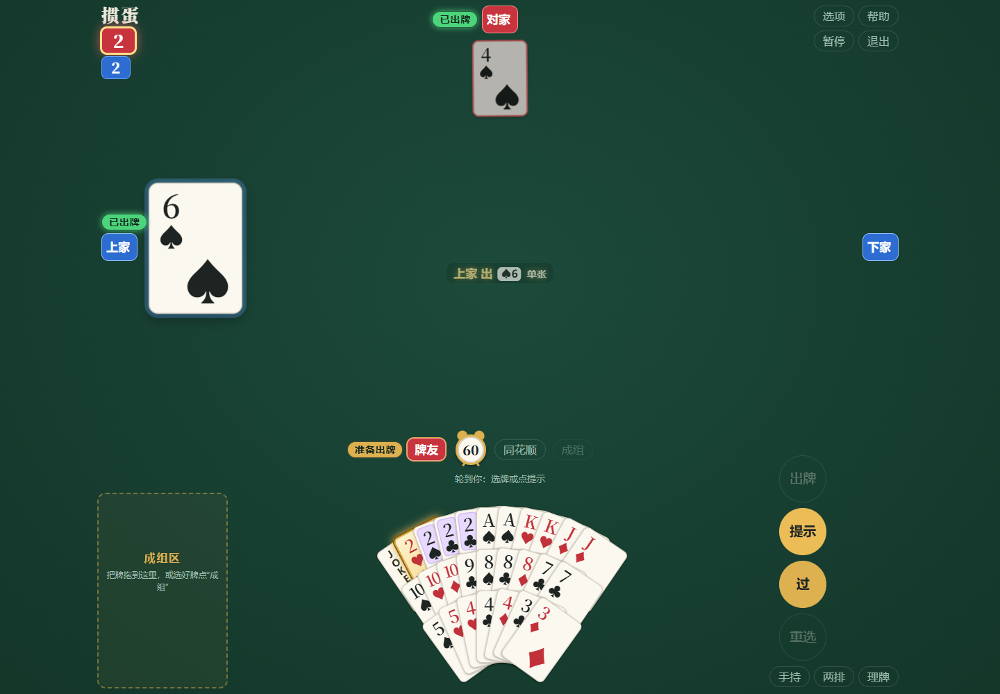
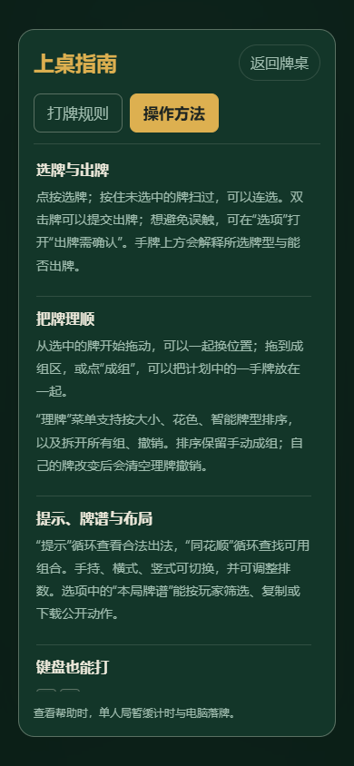
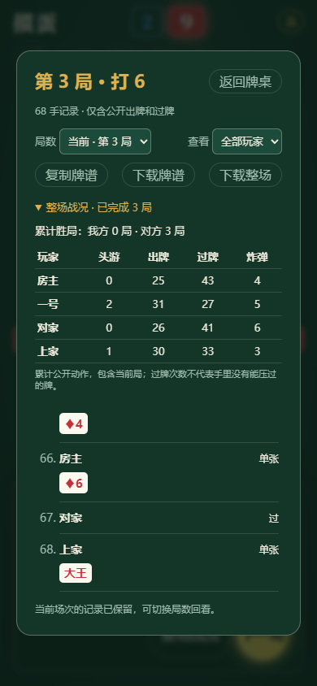

<div align="center">

# GuandanAI

[English](./README.en.md) · 简体中文

### 掼蛋朋友局 · 打开网页，就坐一桌

四人组队、房间邀请、浏览器内智能对手。电脑和手机都能玩。

[](https://github.com/stevensun1005/guandanai/actions/workflows/pages.yml)
[](./CHANGELOG.md)


**[立即开局](https://stevensun1005.github.io/guandanai/) · [玩法指南](./web/docs/PLAYING.md) · [下载发布包](https://github.com/stevensun1005/guandanai/releases/latest) · [开发指南](./CONTRIBUTING.md) · [更新记录](./CHANGELOG.md)**

</div>



<details>
<summary>更多界面：操作帮助与整场战况</summary>

<p align="center"> </p>

</details>

## 代码与模型入口

**[网页端 web/](web/README.md) · [AI ai/](ai/README.md) · [本机模型](ai/local/README.md) · [GuanZero](ai/guanzero/README.md)**

按功能寻找文件、运行数据和研究记录，见各目录 README。[旧路径迁移说明](ai/research/STRUCTURE_MIGRATION.md)。

## 一张链接，一桌朋友

1. 打开游戏，输入昵称，选择 **开房间**。
2. 选择自己的座位，点 **复制邀请链接** 发给朋友。
3. 朋友打开链接、输入昵称、选择座位。房主点 **开始**。

没人坐的座位由电脑接管，一个人也能直接开局。朋友刷新原标签页后可恢复座位；对局期间请保持房主页面打开。详见 [房间与恢复](./web/docs/ROOMS.md)。

大厅中央可选开局级数与南北／东西方，打 A 可选「一次机会」桌规；同花顺提示会显示总种数与当前组合。详见 [上桌指南](./web/docs/PLAYING.md)。

## 已经能做什么

| 体验     | 内容                                                          |
| -------- | ------------------------------------------------------------- |
| 四人掼蛋 | 两副牌、百搭、同花顺、进还贡、接风、升级打 A                  |
| 朋友房间 | 邀请链接、房间号、座位选择、掉线接管与原标签页恢复            |
| 智能电脑 | 按训练版本选择模型，全部在浏览器后台推理                      |
| 手牌操作 | 拖动、扫选、成组、智能理牌、按花色排序、撤销重做、三种布局    |
| 出牌辅助 | 合法出牌提示、同花顺查找、可选二次确认、跨局牌谱与整场战况    |
| 对局氛围 | 音效、全屏、可选语音、出牌动画与结果展示                      |
| 静态部署 | GitHub Pages 自动发布，默认模型随网页部署，研究检查点单独归档 |

大厅依次提供 **Clint规则机器人、GuanZero 最近两代、danMCai 初始版及最近两代冠军**。默认使用**本机现任门控冠军**，点「全部使用本地冠军」可重置。冠军依据训练系统实际门控晋升，不按步数最新替代，不代表独立棋力验收。每四小时同步；旧权重保留归档。GuanZero 使用 `guanzero-adp-gpubatch-44752` 这样的名称。具体版本与默认值见 [电脑选择与发布](./web/docs/WEB_MODELS.md)。

至少两名真人的联机局结束后，房主会自动把匿名结构化牌谱保存到云端；支持断网暂存、补传与去重。牌谱可私有导出为 JSON／JSONL，供后续研究人类行为，当前训练不会自动读取。[采集与导出](./web/collector/README.md)。

## 为浏览器而做

想看清一局牌，可以从大厅进入 **[复盘练习](./web/docs/PRACTICE.md)**：四家明牌、单步推进、写评语、回看，记录可以导出后在其他设备导入。

练习桌的操作区位置固定，出完牌也能继续和撤回；已出牌可滚动查看，评语与结算收在左下角。电脑和平板都能保留清楚的牌桌空间。

玩家无需安装 Node.js、Python 或桌面客户端。页面加载后，电脑出牌由 Web Worker 和 WebAssembly 在房主浏览器中计算。模型只接收自己的手牌、公开出牌、剩余张数和级数。训练过程、历史单把成绩和适用范围见 [模型训练指南](./ai/research/MODEL_TRAINING.md)。

**[模型研究报告](./ai/research/MODEL_STUDY.md)** 记录网络结构、学习算法、完整比赛目标、正负实验结果及证据局限。定期发布最新权重不等于已证明棋力提升；开发集成绩不等于独立验收。

需要在本机运行电脑时，才下载推理组件和模型；加入朋友房间的玩家无需先等模型加载。资源加载失败时会给出重试入口，不会悄悄切换成另一种电脑策略。

## 本地运行

准备 Node.js **20.19+**；项目 CI 使用 Node.js 24。

```bash
git clone https://github.com/stevensun1005/guandanai.git
cd guandanai
npm ci
npm run build
npm run dev
```

打开 **http://127.0.0.1:8765/**。修改源文件后重新构建，再刷新页面。

```bash
npm test              # 规则、输入校验、模型特征和模块边界
npm run format:check  # 代码与文档格式
npm run build         # 完整生产构建
```

Python 用于开发阶段的模型训练、导出和浏览器验证，普通玩家与静态构建都不需要。详见 [贡献指南](./CONTRIBUTING.md)与[验证指南](./web/docs/TESTING.md)。

验证已覆盖三种窗口尺寸、双模型数值、座位恢复与三场完整自动比赛，合计 **37 局、2,957 手**；包含双端和四端。运行环境与结果见 [验证指南](./web/docs/TESTING.md)。

## 看得懂，也改得动

```text
web/                      网页端
  src/                    游戏、界面、联机与浏览器推理
  tools/                  构建、预览与打包
  tests/                  网页与浏览器验证
  docs/                   玩法、操作与部署
ai/                       AI
  local/                  本机模型的训练、数据、评测、权重
  guanzero/               GuanZero 的独立训练与评测
  shared/                 公共模拟与固定测试局面
  research/               研究报告、交接与实验结果
  publishing/             网页模型发布与归档
  environment/            Python 依赖清单
```

源代码采用 ES Modules。生产构建负责打包、资源处理与版本标识；`web/dist` 是构建结果，不是开发入口。模块约定见 [架构文档](./web/docs/ARCHITECTURE.md)。

## 发布你自己的版本

PR 会执行测试、格式、构建和真实浏览器出牌／牌谱导入检查；向 `main` 推送并通过检查后发布到 GitHub Pages。Pages 的 Source 选择 **GitHub Actions**。文档和实验检查点的归档推送不触发网站部署。

也可以把 `npm run build` 生成的 `web/dist` 目录完整上传到静态网站。请保留 `assets/` 与 `models/` 的相对位置，不要只上传 `index.html`。

## 常见问题

**朋友刷新还能回来吗？** 可以，在原标签页会尝试恢复原座位，等待期间由电脑接管。主动退出、切换模式或房主重新加载后不能按原局恢复。

**房主能关闭页面吗？** 房主页面负责推进游戏。关闭后，其他人可以在本机选择由电脑继续打，但不会自动产生新的联机房主。

**为什么朋友偶尔连不上？** 联机使用 WebRTC 与公共信令，双方的网络、NAT 和防火墙都会影响连接。双方刷新为相同页面版本后重试。

**模型有没有偷偷看其他人的手牌？** 模型输入仅包含当前座位自己的牌和公开信息。房主浏览器承担整桌游戏状态，这与模型的输入范围是两件事。

**支持哪些设备？** 主要验证现代 Chrome 桌面环境与手机尺寸布局；不同浏览器和真实设备的表现仍欢迎反馈。

## 一起把这一桌做好

欢迎带着可复现的场景提 [Issue](https://github.com/stevensun1005/guandanai/issues)，或提交小而明确的改进。UI 变化请附截图，牌型和策略变化请附具体牌局及验证结果。

[贡献流程](./CONTRIBUTING.md) · [机器人设计](./web/docs/BOTS.md) · [模型训练](./ai/research/MODEL_TRAINING.md) · [测试与评估](./web/docs/TESTING.md)

## 模型研究状态

137 万参数的完整主网已完成逐层解冻实验；公开／明牌评价与新题／重打的四组对照完成了 256 条小试验、1,024 条扩大试验的整场训练轨迹。重打开局不等于独立新牌副，这些训练量也不是胜率验收场数。完成的研究代码、结果及检查点入口均在 `main`；截至已公开记录，尚未通过新的独立整场 80% 验收。当前网页默认由实际冠军晋升记录决定，历史有限实验与普通最新导出不自动替换它。最新方法与结论以[模型研究报告](./ai/research/MODEL_STUDY.md)及其证据快照为准。

开发评测可运行 `npm run eval:table -- --pairs=1000 --opponent=rule`：它复用网页真实决策模块，覆盖风格、公开记忆、直接出完和残局。实际已完成的样本、统计边界与复现命令见[研究报告](./ai/research/MODEL_STUDY.md#54-网页决策流程的整场评测)，不把流程检查当作棋力进步。该旧整场入口的 `rule` 仍是原版规则；Clint 的 GuanZero 评测使用 `--opponents=clint`，两者成绩不混用。

GuanZero 与本机 danMCai 分开训练，支持 GPU 合批推理和只读实时面板。GuanZero 开发评测包含随机、原版规则、P0 与 Clint（rules-v2）；同一冻结模型、固定种子交换阵营，旧检出可独立补评 Clint。已完成结果和使用方式见 [GuanZero](./ai/guanzero/README.md)，不能把开发胜率当成独立验收。

## 文档导航

| 想做什么           | 从这里开始                                                                                                                                   |
| ------------------ | -------------------------------------------------------------------------------------------------------------------------------------------- |
| 开局、理牌或复盘   | [玩法](./web/docs/PLAYING.md) · [明牌练习](./web/docs/PRACTICE.md)                                                                           |
| 邀请朋友或恢复座位 | [房间与恢复](./web/docs/ROOMS.md)                                                                                                            |
| 开发、测试或发布   | [贡献指南](./CONTRIBUTING.md) · [架构](./web/docs/ARCHITECTURE.md) · [测试](./web/docs/TESTING.md) · [部署](./web/docs/DEPLOYMENT.md)        |
| 了解电脑和复现训练 | [机器人](./web/docs/BOTS.md) · [训练入口](./ai/research/MODEL_TRAINING.md) · [历史训练记录](./ai/research/TRAINING_RUN.md)                   |
| 核对模型成绩及计划 | [研究主报告](./ai/research/MODEL_STUDY.md) · [改进建议及实施状态](./ai/research/IMPROVEMENT_PROPOSAL.md) · [迭代路线](./web/docs/ROADMAP.md) |
