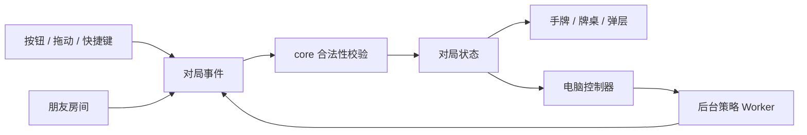

# 架构：规则、流程、界面各归其位

## 设计边界

- `core` 只处理牌和合法性，可以直接在 Node 中测试，不读取 DOM、网络或全局对局状态。
- `game` 是对局控制器：推进阶段、计时、应用事件，并通知相应视图。
- `hand` 管理手牌的排序、分组、显示和出牌提示。
- `ui`、`input`、`effects`、`audio` 负责呈现与交互。
- `network` 传递房间状态和玩家事件；房主决定发牌、电脑动作和超时处理。
- `ai` 在后台 Worker 计算策略结果，最终动作仍经过游戏事件与合法性校验。

## 启动方式

`src/index.html` 只保留语义结构和资源入口。`src/app.js` 导入功能模块，并按依赖要求装配其 `initialize()`：先准备规则与控制器，随后绑定视图、输入、大厅、回放和网络，最后启动页面。

模块的业务函数独立导出；事件监听器和定时器只在各自的初始化函数中注册。导入规则模块不会启动页面，也不会创建网络连接。

## 状态的所有权

`src/app/runtime.js` 持有会被多个功能控制器更新的会话状态。其中：

| 字段                             | 所有权与用途                         |
| -------------------------------- | ------------------------------------ |
| `game`                           | 当前级数、手牌、阶段、出牌记录和回合 |
| `network`                        | 房间角色、座位、连接及待处理事件     |
| `rules`                          | 房间规则                             |
| `selection`                      | 当前玩家选中的实体牌 ID              |
| `names`、`nickname`、`direction` | 显示名称与视角                       |
| 布局、确认、回放字段             | 对应视图控制器维护的临时状态         |

状态通过显式导入访问，不再依赖页面作用域里的 `G`、`NET` 等变量。布局与回放仍有部分共享状态；后续拆分应把它们逐步归回对应功能，避免把 runtime 当作新的万能工具箱。

## 出牌与网络边界

每张牌都有唯一实体 ID。`core/validation.js` 负责：

1. 确认选牌是合法的 ID 列表，没有重复实体牌。
2. 确认牌属于当前手牌。
3. 根据实体牌重新识别牌型并检查是否能压过桌面。
4. 规范化牌型、点数和张数，避免相信消息携带的伪造字段。

先手不能过牌。`core/tribute.js` 统一进贡与还贡选项：优先选择符合要求的低牌，无低牌时使用最小非百搭牌。房间入口、事件、玩家操作和电脑都使用同一套规则。

准备消息重复到达时不重复推进；还贡批次先进入交换阶段，再延迟播放动画。同一局面的交换队列只允许一个执行者。阶段回调同时核对游戏身份、轮次标记、公开记录长度与当前领出者，避免过时动画重写已经前进的状态。

交换牌先一次更新双方的逻辑手牌，再播放动画。规则推进不依赖飞牌何时结束，避免快速准备开打时出现暂时缺牌。

## 座位恢复

`network/recovery.js` 管理原座位凭据、恢复握手与房主快照；`rejoin-storage.js` 只处理标签页存储；`snapshot.js` 是可在 Node 独立检查的视角转换。房主等待稳定逻辑阶段后恢复玩家身份，再发送快照，之后仍按原事件流同步。

视角转换显式列出座位、队伍、进还贡和结果字段，不递归猜测对象中某个数字的意义，避免把牌的点数 `r` 当作座位旋转。恢复后的客人会取消旧动画计时，保留房主剩余时间并重建自己的提示。角色变更由 `game/events.js` 取消过时电脑动作；界面通知由 `ui/overlays.js` 管理。

电脑在理牌时提前还贡，也由房主发出事件；加入者不会各自启动一个独立的还贡计时。未使用的旧恢复入口已删除，正常启动只进入大厅，恢复统一通过房主当前快照进行。

## 纯规则与视图坐标

`core/cards.js` 维护牌、级牌、百搭和基础排序；`core/combinations.js` 负责牌型与大小比较；`core/moves.js` 生成合法牌型。这里不放动画、按钮状态或房间请求。

手机横竖屏、手持扇形和竖列的坐标计算位于 `hand/layout.js`；按牌型分组和提示位于 `hand` 的对应文件。视觉布局变化不应改动出牌合法性。

## 构建与资源版本

`scripts/build.mjs` 使用 esbuild 处理模块、样式和图片，复制模型与浏览器运行库，输出 `dist`。页面、脚本、样式和 Worker 使用源文件及模型共同计算的版本；模型文件使用自身内容版本。界面改动会刷新对应代码，而相同权重可以继续使用浏览器缓存。

`ai/models.mjs` 注册主策略和独立应牌网络，构建按清单复制每个模型并分别计算内容版本。Worker 按模型维护独立会话；主策略先评分，观察型才在合适的非过牌候选上调用应牌网络。

Worker 单独打包自己的特征、风格与残局规则模块，浏览器推理运行库作为同源资源加载。风格只读取 `ai/observation.js` 明确选择的可见信息；残局搜索只使用自己的实体牌、公开记录及剩余张数。

开发源代码按功能拆分；生产资源会合并以减少请求。不要直接修改 `dist`，构建会覆盖它。

## 调试接口

普通页面不暴露旧的全局状态。自动化检查可以通过 `?test=1` 加载测试访问入口；它不属于稳定的产品 API。测试入口只用于定位与复现问题，不能作为房间权限或保密边界。

## 新增功能放哪里

| 改动               | 位置                               |
| ------------------ | ---------------------------------- |
| 新的牌型或大小关系 | `core/combinations.js` 与规则测试  |
| 更好的手牌分组     | `hand`，不在牌面 renderer 中塞策略 |
| 新的电脑引擎或风格 | `ai`，经过合法动作入口             |
| 朋友房间行为       | `network` 与双浏览器验证           |
| 外观变化           | `styles`、`ui` 和真实截图          |
| 记录格式变化       | `replay/storage.js` 与兼容检查     |
