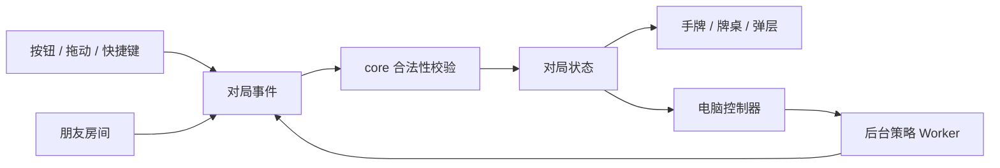

# 架构：规则、流程、界面各归其位

## 设计边界

- `core` 只处理牌和合法性，可以直接在 Node 中测试，不读取 DOM、网络或全局对局状态。
- `game` 是对局控制器：推进阶段、计时、应用事件，并通知相应视图。
- `hand` 管理手牌的排序、分组、显示和出牌提示。
- `ui`、`input`、`effects`、`audio` 负责呈现与交互。
- `network` 传递房间状态和玩家事件；房主决定发牌、电脑动作和超时处理。
- `web/src/ai` 与独立 `web/src/rule-bot` 在后台 Worker 计算策略结果，最终动作仍经过游戏事件与合法性校验。

## 启动方式

`web/src/index.html` 只保留语义结构和资源入口。`web/src/app.js` 导入功能模块，并按依赖要求装配其 `initialize()`：先准备规则与控制器，随后绑定视图、输入、大厅、回放和网络，最后启动页面。

模块的业务函数独立导出；事件监听器和定时器只在各自的初始化函数中注册。导入规则模块不会启动页面，也不会创建网络连接。

## 状态的所有权

`web/src/app/runtime.js` 持有会被多个功能控制器更新的会话状态。其中：

| 字段                             | 所有权与用途                         |
| -------------------------------- | ------------------------------------ |
| `game`                           | 当前级数、手牌、阶段、出牌记录和回合 |
| `network`                        | 房间角色、座位、连接及待处理事件     |
| `rules`                          | 房间规则                             |
| `selection`                      | 当前玩家选中的实体牌 ID              |
| `names`、`nickname`、`direction` | 显示名称与视角                       |
| 布局、确认、回放字段             | 对应视图控制器维护的临时状态         |

状态通过显式导入访问，不再依赖页面作用域里的 `G`、`NET` 等变量。布局与回放仍有部分共享状态；后续拆分应把它们逐步归回对应功能，避免把 runtime 当作新的万能工具箱。

## 出牌与网络边界

每张牌都有唯一实体 ID。`core/validation.js` 负责：

1. 确认选牌是合法的 ID 列表，没有重复实体牌。
2. 确认牌属于当前手牌。
3. 根据实体牌重新识别牌型并检查是否能压过桌面。
4. 规范化牌型、点数和张数，避免相信消息携带的伪造字段。

先手不能过牌。`core/tribute.js` 统一进贡与还贡选项：优先选择符合要求的低牌，无低牌时使用最小非百搭牌。房间入口、事件、玩家操作和电脑都使用同一套规则。

准备消息重复到达时不重复推进；还贡批次先进入交换阶段，再延迟播放动画。同一局面的交换队列只允许一个执行者。阶段回调同时核对游戏身份、轮次标记、公开记录长度与当前领出者，避免过时动画重写已经前进的状态。

交换牌先一次更新双方的逻辑手牌，再播放动画。规则推进不依赖飞牌何时结束，避免快速准备开打时出现暂时缺牌。

## 表情与快捷语

`src/social/emotes.mjs` 是纯数据：5 个表情（礼物 `g01–g03`：卡布奇诺、鲜花、炸弹；表情 `e01–e02`：墨镜、哭）与 8 句快捷语（`p01–p07`、`p12`；原来带出牌暗示的 `p08–p11` 已删除，编号不复用）、按编号查找、收礼座位校验 `validTarget`、按座位冷却以及电脑回礼表 `BOT_REPLIES`。`src/social/controller.js` 负责自己名字牌旁的圆形表情按钮（`#mebar #emoteBtn`，冷却时显示一圈进度）、按钮正上方弹出的分页面板（表情／快捷语两页）与收礼座位选择、气泡定位、礼物飞行与落地特效（Web Animations API，减少动态效果时跳过）、快捷语朗读（浏览器 `speechSynthesis`，`zh-CN`，按座位区分音调，跟随音效开关）和联机转发：客人发送 `{t:'emote', id, to}`，房主在 `network/rooms.js` 收到后校验编号、收礼座位与冷却，再广播 `{t:'emote', seat, id, to}`（房主座位编号）；各页面按本地座位换算。单人局和房主页面在真人把礼物送给电脑座位（`isHumanSeat` 为假）时安排电脑回礼并同样广播。气泡和礼物只用 `textContent` 写入预设文字；CSS 类名带 `kind-` 前缀，避免与进贡动画的 `.gift` 冲突。表情不经过 `act()`／事件队列，不写入 `G.log`、快照、复盘或采集队列。

## 座位恢复

`network/recovery.js` 管理原座位凭据、恢复握手与房主快照；`rejoin-storage.js` 只处理标签页存储；`snapshot.js` 是可在 Node 独立检查的视角转换。房主等待稳定逻辑阶段后恢复玩家身份，再发送快照，之后仍按原事件流同步。

视角转换显式列出座位、队伍、进还贡和结果字段，不递归猜测对象中某个数字的意义，避免把牌的点数 `r` 当作座位旋转。恢复后的客人会取消旧动画计时，保留房主剩余时间并重建自己的提示。角色变更由 `game/events.js` 取消过时电脑动作；界面通知由 `ui/overlays.js` 管理。

电脑在理牌时提前还贡，也由房主发出事件；加入者不会各自启动一个独立的还贡计时。未使用的旧恢复入口已删除，正常启动只进入大厅，恢复统一通过房主当前快照进行。

## 纯规则与视图坐标

`replay/match-record.js` 投影每局公开动作、座位名称和结算，不复制手牌、牌堆或控制器状态。结束局写入 `game.roundHistory`，同局重复结算替换记录，最近 200 局保留在当前比赛内。`ui/match-summary.js` 呈现累计数据，牌谱弹窗负责选局、筛选和文本导出。恢复快照显式旋转历史局的座位、队伍、名次、名称和公开动作。

`core/cards.js` 维护牌、级牌、百搭和基础排序；`core/combinations.js` 负责牌型与大小比较；`core/moves.js` 生成合法牌型。这里不放动画、按钮状态或房间请求。

手机横竖屏、手持扇形和竖列的坐标计算位于 `hand/layout.js`；按牌型分组和提示位于 `hand` 的对应文件。视觉布局变化不应改动出牌合法性。

## 构建与资源版本

`web/tools/build.mjs` 使用 esbuild 处理模块、样式和图片，复制模型与浏览器运行库，输出 `web/dist`。页面、脚本、样式和 Worker 使用源文件及模型共同计算的版本；模型文件使用自身内容版本。界面改动会刷新对应代码，而相同权重可以继续使用浏览器缓存。

网页模型由 `web/src/ai/model-catalog.json` 注册数字编号、默认值、网络配置、来源、完整 SHA-256 和不可变 Release 地址。构建从 Release 获取新增权重，校验后复制到同源 Pages 目录；Worker 按编号维护独立会话。`web/src/ai/models.mjs` 仍保留历史 P0／R1 配置供研究复现。大厅仅显示 Clint、GuanZero 最近两代、danMCai 初始版和两代danMCai 冠军；默认当前门控冠军。GuanZero 名称为 `训练任务名-版本数值`，完整不可变归档仍保留在清单。大厅不再提供性格偏好；房间开始、重连及转为单机都同步或旋转座位对应的编号。发布流程见 [WEB_MODELS.md](./WEB_MODELS.md)。

Worker 单独打包自己的特征、风格与残局规则模块，浏览器推理运行库作为同源资源加载。编号模型只读取 `web/src/ai/observation.js` 明确选择的可见信息；残局搜索只使用自己的实体牌、公开记录及剩余张数。

`web/src/ai/table-policy.mjs` 集中维护输入准备、直接出完捷径和 Worker 决策。控制器继续负责过时结果、回合身份与动作合法性检查；Worker 负责会话加载和消息队列。`ai/shared/simulation/table-inference.mjs` 在 Node 内使用同一决策模块与浏览器 WASM，`evaluate-table.mjs` 按完整比赛评测，不再另写一份性格／搜索逻辑。整场模拟器为它补充已经结束的公开出牌记录及公开整场进度，不把其他玩家手牌送入模型。

页面用 CSP 限制脚本来源，并显式允许 WebAssembly；牌谱文本仍须在写入 HTML 前转义，不能用 CSP 替代输入与渲染边界校验。当前联机事件仍含全量发牌与恢复状态；模型的公开信息边界不能解释为网络层已实现手牌保密。

开发源代码按功能拆分；生产资源会合并以减少请求。不要直接修改 `web/dist`，构建会覆盖它。

## 结束局牌谱采集

`web/src/collection` 在合格联机局结束后由房主异步提交结构化牌谱，IndexedDB 管理待上传队列、补传及去重。接收服务位于 `web/collector`，服务端重放校验后写入独立 D1；它不计算电脑出牌，也不负责房间实时推进。

原始研究记录可包含结束局的四手起牌和完整动作，因此与玩家导出的公开战况是不同产物。云端数据不公开列举，导出需要私有凭据；来源标为 `unverified_browser`。预处理按整场分组、排除电脑／托管／测试动作，不直接写入当前训练。[协议与部署](../collector/README.md)。

## 调试接口

普通页面不暴露旧的全局状态。自动化检查可以通过 `?test=1` 加载测试访问入口；它不属于稳定的产品 API。测试入口只用于定位与复现问题，不能作为房间权限或保密边界。

## 新增功能放哪里

| 改动               | 位置                                                 |
| ------------------ | ---------------------------------------------------- |
| 新的牌型或大小关系 | `core/combinations.js` 与规则测试                    |
| 更好的手牌分组     | `hand`，不在牌面 renderer 中塞策略                   |
| 新的电脑引擎或风格 | `web/src/ai` 或 `web/src/rule-bot`，经过合法动作入口 |
| 朋友房间行为       | `network` 与双浏览器验证                             |
| 外观变化           | `styles`、`ui` 和真实截图                            |
| 记录格式变化       | `replay/storage.js` 与兼容检查                       |

## 独立的冠军评价器

`src/coach/evaluation.mjs` 定义公开观察、候选输入、冠军身份与相对值换算；`controller.js` 管理个人偏好、按回合缓存、快照失效与 UI。评价复用 `ai-worker.mjs`／`inferPolicy` 的模型加载及批量推理，但使用独立 Worker 实例，不走电脑动作选择、性格或残局搜索。房主许可放在同步的 `rules.coachAllowed`，个人开关留在本机。经确认的人工动作在 `doPlay` 修改手牌前保留评价快照，预评展示标记进入独立采集协议，不把分数发给其他玩家。[协议说明](MOVE_COACH.md)。

Top 5 由评价缓存排序，同点数方案保留最佳花色变体，推荐点击不发出牌事件。`private-table/state.mjs` 与 `controller.js` 管理房主本机资格、展示及采集排除；完整手牌仅进入独立 `oracle` 请求。`coach/oracle.mjs` 复用共享 `advanceRound` 和冠军网络做有限推演，不改变普通规则、候选、编码或模型权重。对手分支与普通评价继续采用公开观察。
