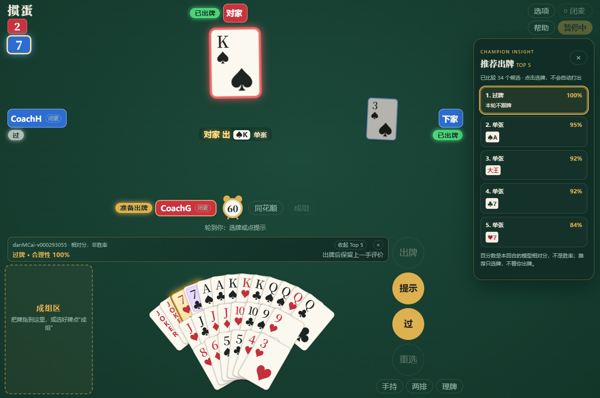

# 出牌评价：房主允许，玩家自选

单人局的开局页可直接勾选「启用我的出牌评价与 Top 5」，也可在牌桌选项里随时切换。

普通朋友房间的开房页有独立的「允许玩家使用出牌评价」开关，**每个新房间默认不允许**。加入者只能查看，不能替房主更改。许可随开局与重连快照同步，本场开始后没有中途修改许可的入口。单人局可直接使用。

允许的房间中，每位玩家可在大厅选择本人是否启用，也可到牌桌「选项 → 出牌评价」自行开启或关闭。首次关闭，之后记住本人在该浏览器的选择；不会改变其他玩家的选择。房主不允许时，自己的旧偏好不能启用评价。明牌练习不提供这项功能。

轮到本人时，选牌显示预评；没有选牌且可以过时，预评的是过牌。非法组合不评分。打出或过牌后，保留上一手的评分。新一把、退出或关闭功能会清理本次评价；刷新记住开关，上一手评分不写入永久存储。

## Top 5 推荐窗口

电脑窗口宽度达到 900 像素时，Top 5 使用独立右侧栏，牌桌、顶部选项和手牌工具为它预留空间；列表过长时在栏内滚动。收起 Top 5 后牌桌恢复宽度，当前选牌预评仍保留。手机和更窄的窗口使用可收起小窗，给出牌按钮留出空间。轮到本人时，按冠军动作值排序，显示最多五种不同出牌方案、具体花色点数和相对合理性；合法方案不足五种时只显示实际数量。相同点数／牌型的花色变体合并，保留模型值最高的实际用牌；百搭使用方式仍区分。歧义百搭采用与实际选牌出牌相同的最强合法解读，避免显示不能按该牌型打出的建议。

点击推荐只会选中这些牌；仍需本人点「出牌」或「过」。普通模式每回合只做一次完整候选评分，反复选牌使用缓存。合法但未生成的出法补算后会更新本回合的比较范围。对手行动期间不把尚未确定的未来牌型当作当前评分。

窗口可单独收起，评价开关仍独立；关闭评价会停止其 Worker。推荐窗口已经展示数字，即使尚未选牌，也算展示过预评。



合成测试局面的实际浏览器画面，不是棋力或正确率结果。

真实浏览器联机测试画面，使用测试玩家与牌局；截图不是棋力或正确率结果。

## 百分数表示什么

冠军更新会随正式发布同步到普通评价、Top 5 和独立房主明牌工具的网络来源；已有页面保留其加载版本，刷新后取新清单。模型身份以 [WEB_MODELS](WEB_MODELS.md) 为准，动作值仍不是胜率。

评价器固定使用清单 `selection.danMCaiChampions[0]` 的danMCai 冠军，与自己的托管模型、其他电脑选了 Clint 还是 GuanZero 无关。界面显示实际冠军版本，之后随正式网页发布同步更新；正在进行的页面不热换权重。

对出牌前同一份可见局面，生成合法候选并用完整冠军网络输出动作值 `Q`。不叠加性格、Clint 规则、残局搜索或直接出完的评分捷径。相对合理性为：

```text
100 × (Q(所选) - 本次候选最低值) / (本次候选最高值 - 最低值)
```

Top 5 第二名起另外显示与第一名的模型值差（单位约等于升级分），因为百分数会把很小的差距放大。显示取整到 0–100%。例如最低 -2、最高 2，所选为 1，显示 75%。分差小于 `1e-6` 时统一显示 100%，同时注明「候选无明显分差」；只有一种合法动作也属于这种情况。比较范围是候选生成器提供的去重出法；若合法选牌未被候选覆盖，会额外计算该动作并纳入比较。同一实体牌的两副副本编码等价。

动作值 `Q` 估计的是这手牌之后**整局**的结果（本队最终升级分），不是这一轮能不能压住、能不能拿到牌权。一手牌即使能拿到牌权，如果对最终胜负帮助很小，它的值也应和其他选项接近；所以看 Top 5 时请同时看分差，而不是只看谁排第一。

**它不是正确概率、整场胜率、专家认可比例或置信度。** 100% 只表示当前候选中的最高模型值，模型仍可能判断错误。不同局面的候选范围不同，不能把这些百分数的平均数当成玩家实力排名。本次没有用专家标签校准百分数，也没有训练新模型。

## 对局与资源边界

每位玩家只在自己的浏览器开启一个独立评价 Worker，只传本人手牌、公开张数、公开牌史及本人视角的双方级数；不传其他三手私牌。电脑的出牌 Worker、模型选择和计时不变，玩家无需等待评分就能出牌。每个本人回合只做一次完整候选推理，切换选牌复用结果；首次使用按需加载冠军权重。关闭会终止评价 Worker 并释放其运行资源，加载失败显示不可用和重试，不捏造 0% 或拦截正常出牌。

预评只在本人实际轮到出牌时计算，其他玩家出牌期间可以预选但不根据尚未形成的未来局面评分。迟到回复按局面快照处理，关闭后不再显示。手机、横屏和平板上的评价栏为出牌按钮留出空间。

## 与真人训练数据的关系

当同一手出牌之前确实展示过数字预评，包括 Top 5 列表中的数字，提交动作带可选 `assisted=true`。只是开关打开、仍在加载、仅有出牌后回顾，都不足以标记为已展示预评；展示后再关闭开关也不会抹掉本手标记。该标记表示浏览器展示过，不证明玩家真正阅读或采纳了建议。

云端原始牌谱保留此信息，默认预处理排除这些动作，避免与未展示该神经网络预评的人工动作混用。`schema=1` 接收端兼容旧记录；其他测试、电脑和超时排除政策继续有效。数据不自动接入冻结训练。

## 验证入口

```bash
node --test web/tests/coach.test.mjs
python web/tests/coach_smoke.py --solo-only
python web/tests/coach_smoke.py http://127.0.0.1:8765/
```

单人检查包含实际冠军 WASM 推理、极值评分、缓存、非法选牌、关闭竞态、失败重试及三种尺寸。完整检查另通过真实 PeerJS 数据通道验证房主许可、玩家独立选择、双方级数不同的加入者视角、出牌标记和刷新恢复；页面以 `?test=1` 打开，测试操作不作为真人训练样本或棋力比赛。机器结果索引见[研究报告](../../ai/research/MODEL_STUDY.md)。

## 独立明牌工具

房主本机的进阶明牌工具采用单独的完整牌面输入与冠军网络有限推演；不是新训练的明牌网络，也不改变普通评价的输入。其评分范围限于实际评估的分支，不保证找到最优解，不能与普通评分直接作横向比较。启用条件、电脑队友范围和采集隔离见 [明牌工具](PRIVATE_TABLE.md)。
