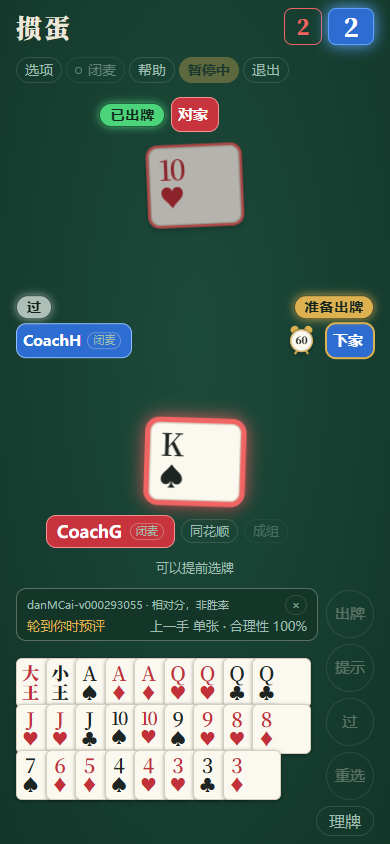

# 出牌评价：房主允许，玩家自选

开房页有独立的「允许玩家使用出牌评价」开关，**每个新房间默认不允许**。加入者只能查看，不能替房主更改。许可随开局与重连快照同步，本场开始后没有中途修改许可的入口。单人局可直接使用。

允许的房间中，每位玩家到牌桌「选项 → 出牌评价」自行开启或关闭。首次关闭，之后记住本人在该浏览器的选择；不会改变其他玩家的选择。房主不允许时，自己的旧偏好不能启用评价。明牌练习不提供这项功能。

轮到本人时，选牌显示预评；没有选牌且可以过时，预评的是过牌。非法组合不评分。打出或过牌后，保留上一手的评分。新一把、退出或关闭功能会清理本次评价；刷新记住开关，上一手评分不写入永久存储。



真实浏览器联机测试画面，使用测试玩家与牌局；截图不是棋力或正确率结果。

## 百分数表示什么

评价器固定使用清单 `selection.localChampions[0]` 的本机冠军，与自己的托管模型、其他电脑选了 Clint 还是 GuanZero 无关。界面显示实际冠军版本，之后随正式网页发布同步更新；正在进行的页面不热换权重。

对出牌前同一份可见局面，生成合法候选并用完整冠军网络输出动作值 `Q`。不叠加性格、Clint 规则、残局搜索或直接出完的评分捷径。相对合理性为：

```text
100 × (Q(所选) - 本次候选最低值) / (本次候选最高值 - 最低值)
```

显示取整到 0–100%。例如最低 -2、最高 2，所选为 1，显示 75%。分差小于 `1e-6` 时统一显示 100%，同时注明「候选无明显分差」；只有一种合法动作也属于这种情况。比较范围是候选生成器提供的去重出法；若合法选牌未被候选覆盖，会额外计算该动作并纳入比较。同一实体牌的两副副本编码等价。

**它不是正确概率、整场胜率、专家认可比例或置信度。** 100% 只表示当前候选中的最高模型值，模型仍可能判断错误。不同局面的候选范围不同，不能把这些百分数的平均数当成玩家实力排名。本次没有用专家标签校准百分数，也没有训练新模型。

## 对局与资源边界

每位玩家只在自己的浏览器开启一个独立评价 Worker，只传本人手牌、公开张数、公开牌史及级数；不传其他三手私牌。电脑的出牌 Worker、模型选择和计时不变，玩家无需等待评分就能出牌。每个本人回合只做一次完整候选推理，切换选牌复用结果；首次使用按需加载冠军权重。关闭会终止评价 Worker 并释放其运行资源，加载失败显示不可用和重试，不捏造 0% 或拦截正常出牌。

预评只在本人实际轮到出牌时计算，其他玩家出牌期间可以预选但不根据尚未形成的未来局面评分。迟到回复按局面快照处理，关闭后不再显示。手机、横屏和平板上的评价栏为出牌按钮留出空间。

## 与真人训练数据的关系

当同一手出牌之前确实展示过数字预评，提交动作带可选 `assisted=true`。只是开关打开、仍在加载、仅有出牌后回顾，都不足以标记为已展示预评；展示后再关闭开关也不会抹掉本手标记。该标记表示浏览器展示过，不证明玩家真正阅读或采纳了建议。

云端原始牌谱保留此信息，默认预处理排除这些动作，避免与未展示该神经网络预评的人工动作混用。`schema=1` 接收端兼容旧记录；其他测试、电脑和超时排除政策继续有效。数据不自动接入冻结训练。

## 验证入口

```bash
node --test web/tests/coach.test.mjs
python web/tests/coach_smoke.py --solo-only
python web/tests/coach_smoke.py http://127.0.0.1:8765/
```

单人检查包含实际冠军 WASM 推理、极值评分、缓存、非法选牌、关闭竞态、失败重试及三种尺寸。完整检查另通过真实 PeerJS 数据通道验证房主许可、玩家独立选择、出牌标记和刷新恢复；页面以 `?test=1` 打开，测试操作不作为真人训练样本或棋力比赛。机器结果索引见[研究报告](../../ai/research/MODEL_STUDY.md)。
