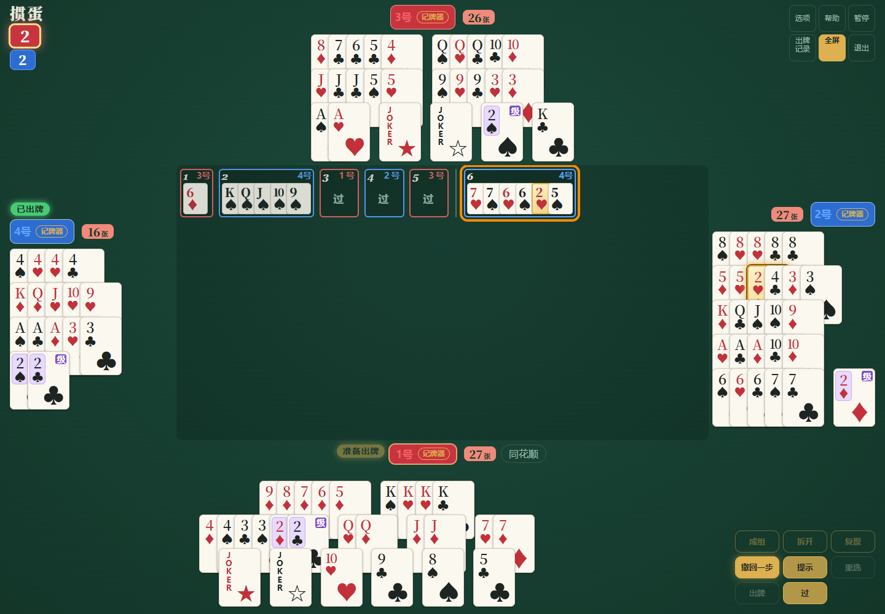

# 配牌、牌局与复盘训练

明牌练习不进入真人联机牌谱云端采集；练习记录仍通过本指南的导出／导入操作交换。普通联机的匿名采集条件见 [房间指南](ROOMS.md)。

复盘练习是一张四家明牌的单机桌，适合理清牌型、比较出法和记录想法。它与朋友房间分开：进入时会说明明牌规则，并离开正在准备的联机房间。

## 从大厅进入

点「训练 · 配牌、牌局与复盘」，先选「配牌」或「牌局」。「残局」显示为准备中，暂不能进入。公开入口不需要密码；这里是人的练习界面，不会启动模型梯度训练。选「牌局」进入原来的四家明牌复盘桌。洗牌、切牌、理牌结束后开始练习；电脑每次出牌前会停下。

点「继续」或按空格推进下一家；按钮说明会标明接下来行动的座位。轮到自己时照常选牌、提示和出牌。「撤回一步」恢复练习进度，记录栏的「看上一手」只打开当时的画面。两种操作不会影响普通对局。

右下角的操作网格位置固定，手牌变少或出完后仍可继续与撤回。「理牌结束」「继续」「下一局」共用同一位置；触屏上的按钮保留至少 44 像素高度。四家余牌数始终显示，理牌参考分在开始出牌后收起，名次显示在名字旁。

中间的已出牌保持可读大小，牌多时可以滚动，不会为了塞入整局记录而不断缩小。评语框和局末总结放在左下角，评语框仍可拖动并记住位置。

四家牌与记录较多，在电脑或平板上更容易观察。全屏是可选操作，不再自动强制全屏或锁定方向。

## 配牌：一次练一家的分组

选「配牌」后，上方是电脑给出的分组参考，下方是自己的同一手 27 张牌。选中多张牌后可以「成组」「拆开」或「并入这组」；被拆动组里的余牌会重新整理。也可恢复电脑的分法。蓝框表示选择，金框标明与参考不同的组；键盘 Tab 和 Enter／空格也可选牌。

每家点「完成」保留记录并进入下一家。四家结束后看总结，点 1–4 号可重看／重记；「这家不记了」只跳过，不伪造记录。下一副可随机选择级牌，也可固定级牌。手机纵屏可滚动查看完整界面；「训练首页」或 Escape 返回选择，再选「牌局」可进入原明牌桌。

这里的 **0–100 分组参考分**来自已有理牌估算，是比较分组的提示，**不是冠军网络的动作合理性、胜率或独立棋力成绩**。不成牌型的组会标注，不能因此当作合法出牌。不会改写 danMCai／GuanZero 的出牌或权重。

配牌记录独立保存在当前浏览器，最多最近 500 手，带 `schema:1`、`kind:arrangement-practice`、`source:unverified_browser`、`assisted:true`、页面版本及实体牌／分组。它们看过参考，不能当成未辅助真人样本；不上传联机牌谱数据库，也不自动进入任何冻结训练。完成一手后可随时「导出记录」，总结页也可保存 UTF-8 文本或复制，末尾 `#DATA` 行供程序读取；它与牌局复盘格式不同，不能用「导入牌局」导入配牌记录。清理浏览器或换设备前请先导出。写入失败会显示提示，内存中仍保留记录以供导出。

## 分组与参考分

理牌阶段可以查看或调整分组。这里的参考分来自牌型组合估算，用于比较自己的理牌思路，**不是胜率**。电脑仍通过强化学习策略评估自己的手牌；移动明牌的显示分组不等于改变模型权重或强制它按分组出牌。

## 写下理由，保留一局

打开「出牌记录」，点某一手旁的「评」，写下为什么要出、为什么要过，或哪种出法更合适。评语按纯文字保存。

| 按钮           | 用途                               |
| -------------- | ---------------------------------- |
| 导出本局复盘   | 下载当前一局的出牌与评语           |
| 导出全部       | 下载当前浏览器保留的各局记录       |
| 复制全部       | 将完整文本放进可复制的输入框       |
| 导入           | 选择导出文件，或粘贴完整内容       |
| 看上一手／回放 | 回到历史画面查看牌桌               |
| 清空           | 清除本机已保存记录，正在打的局保留 |

文件为 UTF-8 文本，人可以直接阅读；最后的 `#DATA` 行供程序重新导入，请保留完整。可以把导出文件发给朋友，在另一台设备导入后继续复盘。

## 保存与兼容

本机最多持久保存最近 200 局，保存在这个浏览器中。清理浏览器数据或换设备不会自动转移记录，需要先导出。保存失败时，记录栏会提示先导出备份；不会把失败当成已经保存。

单次导入最多 200 局、8 MB。程序检查实体牌、牌的归属、已打出的重复牌与牌型；损坏的局单独跳过，其余仍可导入。旧版保存在本机的记录会继续读取，并在下一次成功保存后迁移。

## 开发者：记录边界

`replay/record-schema.js` 负责输入校验与旧格式归一化，`storage.js` 负责本机保存及状态通知，`import-export.js` 负责文本与下载流程，`viewer.js` 负责回看。当前便携格式版本为 1，未知的新版本会被拒绝。

`python web/tests/practice_smoke.py` 验证实际练习出牌、评语、导出、全新浏览器导入、损坏记录、旧数据迁移与保存失败提示。规则与数据检查也包含在 `npm test` 中。

`python web/tests/table_layout_smoke.py` 检查桌面、矮屏与触屏的按钮位置、余牌数、可滚动出牌和评语／结算布局。每个窗口的开局出牌使用真实神经网络；溢出、自己出完牌及局末几何检查使用明确标注的显示状态，不计作模型胜率或完整比赛验证。

配牌模型在 `practice/groups.mjs` 校验实体牌分区、编辑与记录标签，`practice/arrangement.js` 负责交互和导出；`python web/tests/arrangement_practice_smoke.py <预览URL>` 实测四家、分组编辑、导出、键盘、保存失败及响应布局，`npm test` 检查两副牌的实体 ID 不被合并或丢失。
